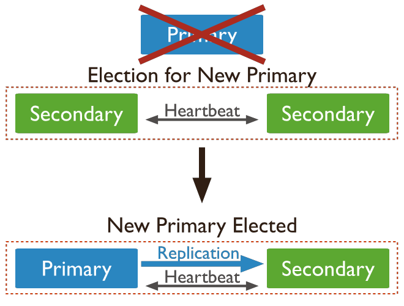

# MongoDB

- Es de documento
- puede trabajar master-salve
- basada en BSON (binary json)

## Propiedades

- Sharding -> escalabilidad horizontal (mejor para escritura)


- replicacion para alta disponibilidad (mejor para lectura) -> disponibilidad

## Arquitectura

| Componente | Rol |
|---|---|
| **mongod** | El proceso que guarda los datos |
| **mongos** | Router: manda cada consulta al shard que corresponde |
| **GridFS** | Almacena archivos de más de 16 MB |

## SQL vs MongoDB

| SQL | MongoDB |
|---|---|
| Tabla / fila / columna | Colección / documento / campo |
| `CREATE TABLE users ...` | `db.createCollection("users")`, o directamente el primer insert |
| `INSERT INTO users VALUES (...)` | `db.users.insertOne({...})` |
| `SELECT * FROM users WHERE status = 'A' ORDER BY user_id DESC` | `db.users.find({status: "A"}).sort({user_id: -1})` |
| `UPDATE users SET status = 'C' WHERE age > 25` | `db.users.updateMany({age: {$gt: 25}}, {$set: {status: "C"}})` |
| `DELETE FROM users WHERE status = 'D'` | `db.users.deleteMany({status: "D"})` |
| `JOIN` | `$lookup` |
| `GROUP BY` | `$group` |

```javascript
use miBase                 // crea la base si no existe y la selecciona
show dbs                   // lista las bases
show collections           // lista las colecciones
db.miColeccion.drop()      // borra la colección
db.dropDatabase()          // borra la base
```

> [!NOTE]
> La cátedra usa `insert()` y `update(..., {multi: true})`. Hoy están deprecados y se usan `insertOne` / `insertMany` y `updateOne` / `updateMany`.

## CRUD

```javascript
// Insert: si no pasás _id, Mongo genera un ObjectId (que incluye la fecha de creación)
db.post.insertMany([
  { title: 'MongoDB Overview', by: 'tutorials point', likes: 100, tags: ['mongodb', 'NoSQL'] },
  { title: 'NoSQL Database', by: 'tutorials point', likes: 20,
    comments: [ { user: 'user1', message: 'My first comment' } ] }   // schema free: otros campos
])

// Find: filtro (where) + proyección (select). _id sale siempre salvo _id: 0
db.post.find({ by: 'tutorials point' }, { _id: 0, title: 1, likes: 1 })

// Update: sin $set reemplaza el documento entero
db.post.updateOne({ title: 'MongoDB Overview' }, { $set: { likes: 101 } })

// Delete
db.post.deleteOne({ title: 'NoSQL Database' })
```

## Consultas

| Operador | SQL |
|---|---|
| `{likes: 50}` | `likes = 50` |
| `$lt` / `$lte` / `$gt` / `$gte` / `$ne` | `<` / `<=` / `>` / `>=` / `!=` |
| `$in: [...]` / `$nin: [...]` | `IN (...)` / `NOT IN (...)` |
| `$all: [...]` | El array contiene **todos** esos valores |
| `/^P/i` | `LIKE 'P%'` (regex; la `i` ignora mayúsculas) |

```sql
WHERE likes > 10 AND (by = 'tutorials point' OR title = 'MongoDB Overview')
```

```javascript
db.mycol.find({
  likes: { $gt: 10 },                  // campos separados por coma = AND implícito
  $or: [                               // $or y $and reciben un ARRAY
    { by: 'tutorials point' },
    { title: 'MongoDB Overview' }
  ]
}).sort({ likes: -1 })                 // 1 ascendente, -1 descendente
```

> [!WARNING]
> - `$nin` también devuelve los documentos que **no tienen** el campo.
> - `$elemMatch` pide que **un mismo elemento** del array cumpla todas las condiciones: `{'exports.foods': {$elemMatch: {name: 'bacon', tasty: false}}}`.

## Agregación

`aggregate` recibe un **pipeline**: un array de etapas, y cada etapa recibe la salida de la anterior.

| Etapa | Qué hace |
|---|---|
| `$match` | Filtra (WHERE). Conviene ponerlo primero |
| `$group` | Agrupa (GROUP BY) con `$sum`, `$avg`, ... |
| `$sort` | Ordena |
| `$project` | Elige o renombra campos (SELECT) |
| `$lookup` | Ensambla con otra colección (LEFT OUTER JOIN) |
| `$unwind` | Genera un documento por cada elemento de un array |

```sql
SELECT tipo, COUNT(*) FROM hospitales GROUP BY tipo ORDER BY COUNT(*) DESC
```

```javascript
db.hospitales.aggregate([
  { $group: { _id: "$properties.TIPO", count: { $sum: 1 } } },   // "$campo" = el valor del campo
  { $sort: { count: -1 } }
])
```

```javascript
// JOIN: cada order trae un array inventory_docs con los inventarios que coinciden
db.orders.aggregate([
  { $lookup: {
      from: "inventory",         // la otra colección
      localField: "item",        // campo en orders
      foreignField: "sku",       // campo en inventory
      as: "inventory_docs"       // nombre del array resultante
  } }
])
```

> [!TIP]
> `$lookup` es un **LEFT** join: las órdenes sin coincidencias aparecen con `inventory_docs: []`. Un campo que no existe cuenta como `null`, así que matchea con `sku: null`.

**MapReduce** es la alternativa vieja a `aggregate`: `map` llama a `emit(clave, valor)`, `reduce` combina los valores de cada clave y `finalize` (opcional) hace los cálculos finales.

## Vistas

Una vista es un pipeline guardado que se consulta como si fuera una colección:

```javascript
db.createView("managementFeedback", "survey", [
  { $project: { management: "$feedback.management", department: 1 } }
])
db.managementFeedback.find()
```

## Modelado: embebido vs normalizado

| | Embebido (desnormalizado) | Normalizado (referencias) |
|---|---|---|
| Estructura | Subdocumentos dentro del mismo documento | Documentos separados; uno guarda el `_id` del otro |
| Lectura | 1 consulta | Varias consultas o `$lookup` |
| Escritura | Atómica en una operación | Toca varios documentos |
| Usar cuando | Relación "contiene", one-to-one, one-to-few que se leen juntos | Embeber duplicaría datos, many-to-many, jerarquías grandes |

```javascript
// Embebido: las direcciones se leen siempre con el usuario
{ _id: "joe", name: "Joe Bookreader",
  addresses: [ { street: "123 Fake Street", city: "Faketon" },
               { street: "1 Some Other Street", city: "Boston" } ] }

// Referencia: embeber la editorial en cada libro la repetiría
{ _id: "oreilly", name: "O'Reilly Media", founded: 1980 }
{ _id: 123456789, title: "MongoDB: The Definitive Guide", publisher_id: "oreilly" }
```

> [!TIP]
> Con referencias, la referencia va del lado de los **"muchos"** (el libro apunta a la editorial). Si la pusieras del lado del "uno" (`books: [...]` en la editorial), ese array crecería sin límite.

> [!WARNING]
> Un documento BSON pesa como máximo **16 MB** y admite hasta **100 niveles** de anidamiento.

## Índices

- Toda colección tiene un índice **único sobre `_id`**, que no se puede borrar.
- En la clase, un índice sobre un campo baja una búsqueda en 100.000 documentos de 61 ms a 0 ms.

```javascript
db.phones.createIndex({ display: 1 }, { unique: true })   // la cátedra usa ensureIndex (deprecado)
db.phones.find({ display: "+1 800-5650001" }).explain("executionStats")
```

## Replica sets

> [!IMPORTANT]
> Un **replica set** es un grupo de `mongod` con **los mismos datos**. Uno es el **primary** y el resto son **secondaries**. Sirve para la **redundancia** y la **disponibilidad**.

- **Todas las escrituras van al primary.** Los secondaries copian sus operaciones leyendo el **oplog**.
- Por defecto, las **lecturas también van al primary**. Leer de un secondary hay que configurarlo, y el dato puede estar atrasado.
- Si se cae el primary, los secondaries lo detectan por los **heartbeats** y **eligen uno nuevo** entre ellos.



> [!IMPORTANT] Mayoría (fuera de la cátedra)
> Para elegir primary hacen falta los votos de la **mayoría** de los nodos, por eso se usa una cantidad **impar** (3, 5, ...). Si una partición deja a un grupo sin mayoría, ese grupo no acepta escrituras: se resigna disponibilidad para no perder consistencia. Por eso a Mongo se lo considera **CP** (ver [[6_NoSql#Teorema CAP]]).

```bash
mongod --replSet book --dbpath ./mongo1 --port 27011    # uno por nodo: 27011, 27012, 27013
```

```javascript
rs.initiate({ _id: 'book', members: [
  { _id: 1, host: 'localhost:27011' },
  { _id: 2, host: 'localhost:27012' },
  { _id: 3, host: 'localhost:27013' }
] })
rs.status()
```

## Sharding

> [!IMPORTANT]
> **Sharding** es partir una colección **horizontalmente por rangos de valores** entre varios servidores. Cada parte es un **shard**, y cada shard guarda solo su rango. Es lo que permite escalar horizontalmente (el diagrama de [[#Propiedades]]).

- La **shard key** es el campo que decide a qué shard va cada documento. Sus valores se dividen en rangos llamados **chunks**.
- La aplicación se conecta a **mongos**, que les pregunta a los **config servers** dónde está cada chunk y rutea la consulta. Si la consulta no incluye la shard key, `mongos` tiene que preguntarles a todos los shards.
- *(Fuera de la cátedra)* Si la shard key siempre crece (una fecha, por ejemplo), todas las escrituras caen en el mismo shard. Para evitarlo existe el **hashed sharding**.

| | Replica set | Sharding |
|---|---|---|
| Cada nodo tiene | **Todos** los datos | **Una parte** de los datos |
| Resuelve | Disponibilidad | Escala (datasets grandes, muchas escrituras) |

> [!TIP]
> Se combinan: en producción **cada shard es un replica set**.

```javascript
sh.addShard("localhost:27014")
sh.enableSharding("test")
sh.shardCollection("test.cities", { name: 1 })   // shard key: name
```
