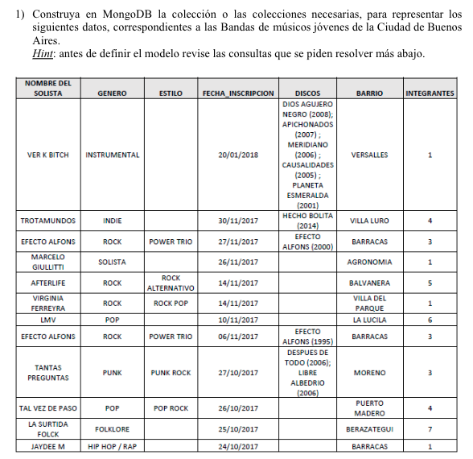
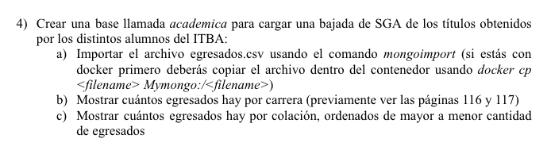

# TP9 MongoDB

## TP1



Bueno a vamos a hacer que los discos esten embebidos. Insertamos todos de esta manera

```js
db.bands.deleteMany({});

db.bands.insertMany([
  {nombre:'VER K BITCH', genero:'INSTRUMENTAL', fecha_inscripcion:new Date('2018-01-20'),
   discos:[
     {title:'DIOS AGUJERO NEGRO', year:2008},
     {title:'APICHONADOS', year:2007},
     {title:'MERIDIANO', year:2006},
     {title:'CAUSALIDADES', year:2005},
     {title:'PLANETA ESMERALDA', year:2001}
   ],
   barrio:'VERSALLES', integrantes:1},
  {nombre:'TROTAMUNDOS', genero:'INDIE', fecha_inscripcion:new Date('2017-11-30'),
   discos:[{title:'HECHO BOLITA', year:2014}], barrio:'VILLA LURO', integrantes:4},
  {nombre:'EFECTO ALFONS', genero:'ROCK', estilo:'POWER TRIO', fecha_inscripcion:new Date('2017-11-27'),
   discos:[{title:'EFECTO ALFONS', year:2000}], barrio:'BARRACAS', integrantes:3},
  {nombre:'MARCELO GIULLITTI', genero:'SOLISTA', fecha_inscripcion:new Date('2017-11-26'),
   barrio:'AGRONOMIA', integrantes:1},
  {nombre:'AFTERLIFE', genero:'ROCK', estilo:'ROCK ALTERNATIVO', fecha_inscripcion:new Date('2017-11-14'),
   barrio:'BALVANERA', integrantes:5},
  {nombre:'VIRGINIA FERREYRA', genero:'ROCK', estilo:'ROCK POP', fecha_inscripcion:new Date('2017-11-14'),
   barrio:'VILLA DEL PARQUE', integrantes:1},
  {nombre:'LMV', genero:'POP', fecha_inscripcion:new Date('2017-11-10'),
   barrio:'LA LUCILA', integrantes:6},
  {nombre:'EFECTO ALFONS', genero:'ROCK', estilo:'POWER TRIO', fecha_inscripcion:new Date('2017-11-06'),
   discos:[{title:'EFECTO ALFONS', year:1995}], barrio:'BARRACAS', integrantes:3},
  {nombre:'TANTAS PREGUNTAS', genero:'PUNK', estilo:'PUNK ROCK', fecha_inscripcion:new Date('2017-10-27'),
   discos:[{title:'DESPUES DE TODO', year:2006}, {title:'LIBRE ALBEDRIO', year:2006}],
   barrio:'MORENO', integrantes:3},
  {nombre:'TAL VEZ DE PASO', genero:'POP', estilo:'POP ROCK', fecha_inscripcion:new Date('2017-10-26'),
   barrio:'PUERTO MADERO', integrantes:4},
  {nombre:'LA SURTIDA FOLCK', genero:'FOLKLORE', fecha_inscripcion:new Date('2017-10-25'),
   barrio:'BERAZATEGUI', integrantes:7},
  {nombre:'JAYDEE M', genero:'HIP HOP / RAP', fecha_inscripcion:new Date('2017-10-24'),
   barrio:'BARRACAS', integrantes:1}
]);
```

bueno ahora con las consultas

2) Todas las bandas en orden de menor a mayor de acuerdo al número de integrantes

```js
db.bands.find().sort({integrantes: 1})
```

3) Las dos bandas con mayor numero de integrantes

```js
db.bands.find().sort({integrantes: -1}).limit(2)
```

4) Sumar un integrante más a todas las bandas

```js
db.bands.updateMany({}, {$inc: {integrantes: 1}})
```

5) Bandas cuyo género es Rock

```js
db.bands.find({genero: 'ROCK'})
```

6) Bandas cuyo género es Rock o su estilo tiene algo de Rock

```js
db.bands.find({$or: [{genero: 'ROCK'}, {estilo: {$regex: 'ROCK'}}]})
```

7) Bandas que han lanzado disco en el año 2006

```js
db.bands.find({'discos.year': 2006})
```

8) Bandas que han lanzado disco después del 2010

```js
db.bands.find({'discos.year': {$gt: 2010}})
```

9) Cantidad de Bandas en el barrio Barracas

de la manera deprecada:
```js
db.bands.find({barrio: 'BARRACAS'}).count()
```

De la manera que es la que va ahora:
```js
db.bands.countDocuments({barrio: 'BARRACAS'})
```

10) Promedio de integrantes por género en orden alfabético, usando una vista llamada bandas_resumen (que deberán crear) que tenga solo los datos del solista, el género de la banda, el barrio y los integrantes

Primero creamos la vista

```js
db.createView(
  'bandas_resumen',   // nombre de la vista
  'bands',            // colección de origen
  [                   // pipeline que define qué muestra
    {$project: {_id: 0, nombre: 1, genero: 1, barrio: 1, integrantes: 1}}
  ]
);
```

y ahora hacemos la consulta del promedio:

```js
db.bandas_resumen.aggregate([
  {$group: {_id: '$genero', promedio_integrantes: {$avg: '$integrantes'}}},
  {$sort: {_id: 1}}
]);
```

11) Cantidad de bandas por barrio, usando la vista creada en el punto anterior, en orden de barrios más musicales a menos

```js
db.bandas_resumen.aggregate([
    {$group: {_id: '$barrio', count: {$sum: 1}}},
    {$sort: {count: -1}}
])
```

## TP2

De este tp vamos a hacer algunos nomas

### Ej 4



Primero copiamos el csv adentro del container

```sh
docker cp ./egresados.csv Mymongo:/egresados.csv
```

y ahora para importarlo

```sh
docker exec Mymongo mongoimport --db academica --collection egresados --type csv --headerline --file /egresados.csv
```

#### b.

```js
db.egresados.aggregate([
    {$group: {
      _id: '$titulo',
      count: {
        $sum: 1
      }
    }}
])
```

#### c.

```js
db.egresados.aggregate([
    {$group: {
      _id: '$colacion',
      count: {
        $sum: 1
      }
    }},
    {$sort: {
      count: -1
    }}
])
```

### Ej6

En este hay que pasar la consulta de sql a mongo

#### a.

consulta sql:

```sql
SELECT nombre_solista
FROM bandas
WHERE genero = 'ROCK' AND integrantes > 2;
```

consulta mongo:

```js
db.bands.find(
    {$and: [
        {genero: 'ROCK'},
        {integrantes: {$gt: 2}}
    ]},
    {_id: 0, nombre: 1}
)
```

#### b.

consulta sql:

```sql
SELECT genero, AVG(integrantes) AS promedio_integrantes, count(*) AS
cant_bandas
FROM bandas
WHERE fecha_incripcion <= '2017-11-27'
GROUP BY genero
ORDER BY promedio_integrantes DESC;
```

consulta mongo:

```js
db.bands.aggregate([
    {$match: {
      fecha_inscripcion: {$lte: new Date('2017-11-27')}
    }},
    {$group: {
      _id: '$genero',
      cant_bandas: {
        $sum: 1
      },
      promedio_integrantes: {
        $avg: '$integrantes'
      }
    }},
    {$sort: {
      promedio_integrantes: -1
    }}
])
```

#### Ej 7

##### Fortalezas

- Puede manejar gran volumen de datos y requests por el escalamiento horizontal
- Modelo de datos flexible (schemaless)
- facil de usar para la gente que viene de escribir sql


##### Debilidades

- El schemaless segun la aplicacion puede ser malo
- Peligroso insertar cualquier valor de cualquier tipo en cualquier collection. Un typo te puede llevar a horas de debuggeo
- clusters pueden ser un toque dificiles de setupear bien

##### Cuando usarla

Mongo is an excellent choice if you are currently using a relational database
to store your data using ORM-style patterns. We often recommend it to
developers steeped in frameworks such as Ruby on Rails and Django because
they can then perform validations and field management through the models
at the application layer and because schema migrations become a thing of
the past (for the most part). Adding new fields to a document is as easy as
adding a new field to your data model, and Mongo will happily accept the new
terms. We find Mongo to be a much more natural answer to many common
problem scopes for application-driven datasets than relational databases.


#### Ej 8

Segun CAP mongo es CP (consistente y tolerante a particiones)